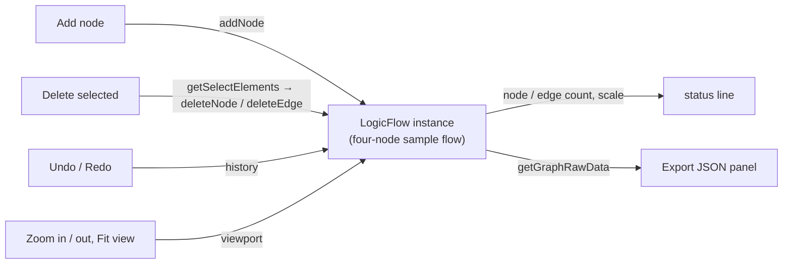

# Demo

The demo lives at [https://shijianjs.github.io/ktjs-logic-flow/demo/](https://shijianjs.github.io/ktjs-logic-flow/demo/).

The demo mounts an editor on a four-node sample flow: drag the nodes, connect them by dragging an
anchor, and the canvas is the library's own rendering. The buttons all go through the wrapper:
**Add node** calls `addNode`, **Delete selected** reads `getSelectElements` and then calls
`deleteNode` / `deleteEdge`, **Undo** / **Redo** use the history, **Zoom in** / **Zoom out** / **Fit
view** move the viewport, and **Export JSON** prints `getGraphRawData` into the panel below. The
status line reports the node and edge counts plus the current scale, and the language switch rewrites
every label.

The language button in the page header switches between English and Simplified Chinese: every
visible string changes, not just the title.

The API reference is at [https://shijianjs.github.io/ktjs-logic-flow/api/](https://shijianjs.github.io/ktjs-logic-flow/api/), generated by Dokka from the published modules.
