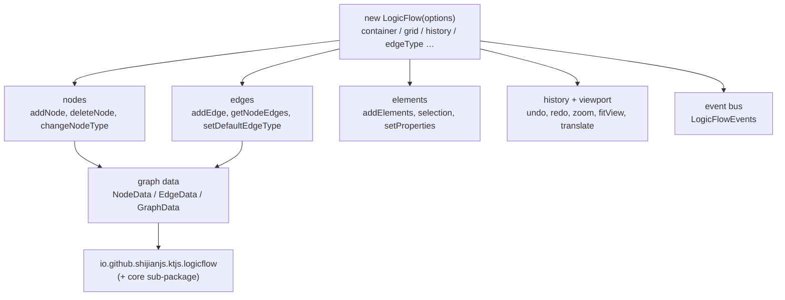

# Introduction

`ktjs-logic-flow` is a Kotlin/JS wrapper for [`@logicflow/core`](https://github.com/didi/LogicFlow) from [LogicFlow](https://github.com/didi/LogicFlow) 2.2.5: every type and member of
the upstream `.d.ts` files becomes an `external` declaration the compiler checks, with no
`dynamic` fallback.

The wrapper covers the `LogicFlow` class of `@logicflow/core` 2.2: the constructor and its options (`container`, `width`, `height`, `background`, `grid`, `keyboard`, `style`, `edgeType`, `history`, `snapline`, `partial`, `stopMoveGraph`, `isSilentMode`, `themeMode`, `plugins` …), node editing (`addNode`, `deleteNode`, `cloneNode`, `changeNodeId`, `changeNodeType`, the `getNode…` lookups), edge editing (`addEdge`, `deleteEdge`, `getEdgeDataById`, `getEdgeModelById`, `getNodeEdges`, `setDefaultEdgeType`), element operations (`addElements`, the selection calls, `setProperties` / `getProperties` / `deleteProperty`, `updateAttributes`, `setElementZIndex`), text (`editText`, `updateText`), the editing configuration, theming, the graph calls (`render`, `renderRawData`, `getGraphData`, `getGraphRawData`, `clearData`), history and viewport (`undo`, `redo`, `zoom`, `fitView`, `translate`, `getTransform` …), edge animation, and the event bus. It also declares the data types (`NodeConfig`, `NodeData`, `EdgeConfig`, `EdgeData`, `GraphConfigData`, `GraphData`, `TextConfig`, `RegisterConfig`) and the `LogicFlowEvents` names.

## What is wrapped

| Module | Gradle artifact | Upstream |
| --- | --- | --- |
| `ktjs-logic-flow` | `io.github.shijianjs:ktjs-logic-flow` | `@logicflow/core` 2.2.5 |

One npm package, one Gradle module, one Kotlin package (`io.github.shijianjs.ktjs.logicflow`) with a `core` sub-package for the options, the data types and the event names.

Everything a page does goes through one `LogicFlow` instance: the graph is the library's own
rendering, and the wrapper only decides what you are allowed to ask it.

## License

The wrapper itself is MIT. The upstream `@logicflow/core` license differs from it — read the
[license notes](guide/license.md) before shipping it commercially.

## Where to go next

- [Getting started](guide/getting-started.md) — add the dependency, make the first call, run the build.
- [API overview](guide/api-overview.md) — package layout, type mapping conventions, common patterns.
- [Demo](guide/demo.md) — see it running in the browser.
