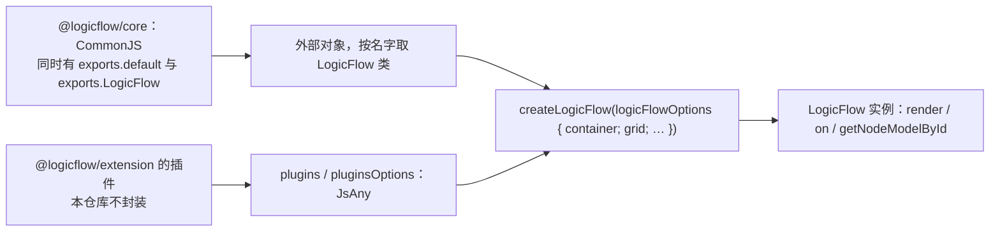

# API 概览

## 包结构

| 包 | 内容 |
| --- | --- |
| `io.github.shijianjs.ktjs.logicflow` | `LogicFlow`、`createLogicFlow`、`logicFlowOf`、`logicFlowModel`、`LogicFlowModule` |
| `…logicflow.core` | `LogicFlowOptions`、`logicFlowOptions`、`LogicFlowBackground`、`BackgroundConfig`、`LogicFlowGrid`、`GridConfig`、`LogicFlowMoveLock`、`LogicFlowKeyboard`、`LogicFlowAnimation`、`EditConfig`、`TransformData`、`GraphConfigData`、`GraphData`、`NodeConfig`、`NodeData`、`EdgeConfig`、`EdgeData`、`TextConfig`、`Position`、`RegisterConfig`、`LogicFlowEvent`、`LogicFlowEvents` |

## 本 wrapper 的约定

- **模块当命名空间用，类按名字取。** `@logicflow/core` 是 CommonJS，同时有 `exports.default` 与
  `exports.LogicFlow`；把模块绑成对象再从中取 `LogicFlow`，在任何 interop 模式下都能工作。
  `createLogicFlow` 再通过 shim 调 `new cls(options)`。
- **对象字面量是「建」出来的，不是「拼」出来的。** `logicFlowOptions`、`graphConfigData`、`nodeConfig`、
  `edgeConfig`、`textConfig`、`BackgroundConfig`、`GridConfig`、`LogicFlowKeyboard`、
  `LogicFlowAnimation` 都是 `unsafeJso` builder：块里没赋值的字段就是「缺席」，而 LogicFlow 把「缺席」
  读成「默认值」。
- **联合类型是不透明类型 + 工厂。** `background` 是 `false | BackgroundConfig`
  （`LogicFlowBackground(false)` / `LogicFlowBackground(backgroundConfig { … })`），`grid` 是
  `number | boolean | GridOptions`（`LogicFlowGrid(20.0)` / `LogicFlowGrid(true)` / …），
  `stopMoveGraph` 是 `boolean | 'vertical' | 'horizontal' | [number,number,number,number]`
  （`LogicFlowMoveLock(…)` 四个工厂）。
- **可选参数用 `definedExternally`。** external 函数的默认值只能是 `definedExternally`，这样「没传参」
  才能真正以「没传」到达库。
- **事件名有类型，负载没有。** `LogicFlowEvents` 收好事件名，拼错即编译错误；事件负载留在
  `LogicFlowEvent` 的 `type` 与 `data` 上。

## 有意放宽的类型

| 成员 | Kotlin 类型 | 原因 |
| --- | --- | --- |
| `LogicFlowOptions.style` | `JsAny?` | 深层 partial 主题，会铺在默认主题之上 |
| `LogicFlowOptions.guards` | `JsAny?` | `{ beforeClone?, beforeDelete? }`，两个否决钩子 |
| `LogicFlowOptions.plugins` | `Array<JsAny>` | 每项是 `@logicflow/extension` 的 `ExtensionConstructor` 或 `ExtensionDefinition` |
| `LogicFlowEvent.data` | `JsAny?` | 每个事件的负载各不相同 |
| `getNodeModelById` / `getEdgeModelById` / `getModelById` | `JsAny?` | 模型类来自 `@logicflow/core/lib/model`，每种元素一个类 |

每一行都是上游真实形状，均记在 `docs/development/technical-decisions.md`。
