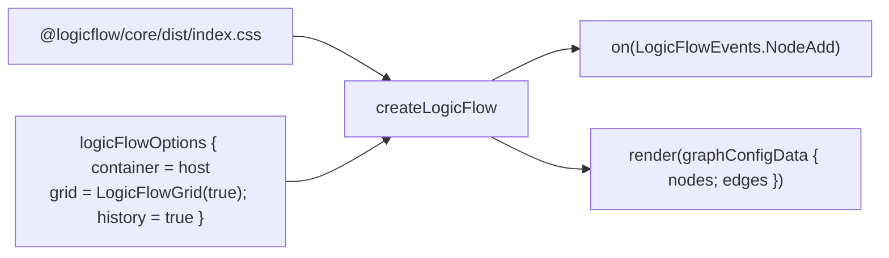

# 快速开始

## 依赖

```kotlin
kotlin {
    js {
        binaries.executable()
        browser()
    }
    sourceSets {
        jsMain.dependencies {
            implementation("io.github.shijianjs:ktjs-logic-flow:2.2.5-kt.1")
            // `kotlin-browser` 的 `web.*` 类型出现在公开 API 里，所以消费方要能编译到它们。
            implementation("org.jetbrains.kotlin-wrappers:kotlin-browser:2026.11.1")
        }
    }
}
```

要求 Kotlin 2.4.21 或更新版本；wrapper 输出 ESM，`es2015` 目标起可用。

## 注册插件

LogicFlow 把可选集成叫 *插件*，它们通过 `plugins` 选项传入，而不是靠 import：

```kotlin
val lf = createLogicFlow(logicFlowOptions {
    container = host
    plugins = arrayOf(menuPlugin, controlPlugin)
    pluginsOptions = menuOptions
})
```

核心包只有一个 import：`@logicflow/core`，wrapper 已绑定好：

```kotlin
import io.github.shijianjs.ktjs.logicflow.createLogicFlow
```

插件本身（`@logicflow/extension`）不在本仓库范围内，因此 `plugins` 与 `pluginsOptions` 声明为
`JsAny`：把从扩展包里导入的构造函数或定义原样传进来即可。



## 第一个调用

```kotlin
import io.github.shijianjs.ktjs.logicflow.core.LogicFlowEvents
import io.github.shijianjs.ktjs.logicflow.core.LogicFlowGrid
import io.github.shijianjs.ktjs.logicflow.core.edgeConfig
import io.github.shijianjs.ktjs.logicflow.core.graphConfigData
import io.github.shijianjs.ktjs.logicflow.core.logicFlowOptions
import io.github.shijianjs.ktjs.logicflow.core.nodeConfig
import io.github.shijianjs.ktjs.logicflow.createLogicFlow

fun mount(host: web.html.HTMLElement) {
    val lf = createLogicFlow(logicFlowOptions {
        container = host
        grid = LogicFlowGrid(true)
        history = true
        edgeType = "polyline"
    })

    lf.on(LogicFlowEvents.NodeAdd) { event -> println("已新增：${'$'}{event.type}") }

    lf.render(graphConfigData {
        nodes = arrayOf(
            nodeConfig { id = "n1"; type = "rect"; x = 120.0; y = 80.0; text = "开始" },
            nodeConfig { id = "n2"; type = "circle"; x = 320.0; y = 80.0; text = "结束" },
        )
        edges = arrayOf(
            edgeConfig { id = "e1"; type = "polyline"; sourceNodeId = "n1"; targetNodeId = "n2" },
        )
    })
}
```

页面必须加载库自带的样式（`@logicflow/core/dist/index.css`），否则画布没有颜色、文本编辑器也会失去布局。

## 构建与测试

```bash
./gradlew build                     # 编译、Detekt、浏览器测试
./gradlew :ktjs-logic-flow:jsBrowserTest     # 只跑 wrapper 的浏览器测试
./gradlew :docs:docusaurusStart     # 文档开发服务器
./gradlew pagesSite                 # 文档在 /，演示在 /demo/，Dokka 在 /api/
```
